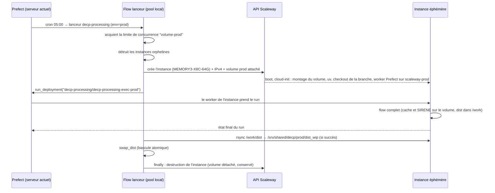

# Exécution des flows lourds sur un serveur Scaleway éphémère

**Statut** : design validé en brainstorming, en attente de relecture de la spec puis de plan d'implémentation
**Date** : 2026-10-31
**Issue** : [#189](https://github.com/ColinMaudry/decp-processing/issues/189)

## Contexte et problème

Le flow `decp-processing` est tué de façon intermittente par l'OOM killer du serveur de production (Dedibox, 31 Go de RAM, sans swap actif au moment des incidents) pendant la consolidation des versions de marché entre datasets. `journalctl -k` l'atteste : process python du worker Prefect tué à ~24 Go d'`anon-rss` le 28/10 à 18:31 et le 30/10 à 06:17. Le worker étant tué avec lui, Prefect ne reçoit jamais d'état final : le run reste affiché sur son dernier log (« Consolidation des versions de marché entre datasets... »). Le caractère intermittent vient de la marge mémoire laissée par les autres services du serveur (colibre, mariadb, gitea…).

Mesures sur les données de production (consolidation seule, ~10 M lignes) : pic de 10,3 Go en polars 1.43 et plus de 15 Go en polars 1.33.1, la version réellement installée dans le venv du worker de prod (le déploiement fait un `git_clone` sans installer les dépendances de `uv.lock`). Le reste du flow (enrichissement SIRENE, anomalies, export) ajoute ses propres pics.

Un partitionnement de la consolidation par hash d'`uid` a été prototypé (pic ramené à ~2-3 Go) puis **abandonné** : plutôt que d'optimiser encore le code au fil de la croissance des données, on se donne de la marge en exécutant les flows lourds sur un serveur dédié, créé pour le run puis détruit.

**Objectif** : `decp-processing` (prod et dev) et `sirene-preprocess` (prod et dev) s'exécutent sur une instance Scaleway éphémère de 64 Go de RAM. Le serveur Prefect, les plannings, les scraps et decp.info restent sur le serveur actuel.

**Critères de succès** :

- le run quotidien de prod se termine sans OOM, publie sur data.gouv.fr et S3 comme aujourd'hui, et met à jour `/srv/shared/decp/prod/dist` lu par decp.info ;
- l'instance est détruite à la fin de chaque run, y compris en cas d'échec ;
- les caches (ressources, SIRENE, cache Prefect) persistent entre deux runs : pas de re-téléchargement intégral à chaque exécution ;
- tous les environnements Python (serveur actuel et instance) tournent sur les versions de `uv.lock`.

**Hors périmètre** :

- l'optimisation mémoire du code de consolidation (partitionnement abandonné) ;
- l'upgrade vers polars 2.1 ([#201](https://github.com/ColinMaudry/decp-processing/issues/201)) ;
- le non-déterminisme de la consolidation (même entrée → sorties différentes d'un run à l'autre), à traiter séparément ;
- l'activation de l'IPv6 sur le serveur Dedibox : indépendante de ce design (voir « Notes »).

## Choix écartés

| Option                                                                    | Raison du rejet                                                                                                                                                                      |
| ------------------------------------------------------------------------- | ------------------------------------------------------------------------------------------------------------------------------------------------------------------------------------ |
| Scaleway Serverless Jobs                                                  | 16 Go de RAM et 10 Go de stockage éphémère maximum par job, `/tmp` compté en RAM ([limites](https://www.scaleway.com/en/docs/serverless-jobs/reference-content/jobs-limitations.md)) |
| Worker Prefect maison « instance Scaleway » (sous-classe de `BaseWorker`) | Plus de code, dépendant de l'API interne des workers Prefect, à packager en plugin ; le rapatriement de `dist/` reste à traiter                                                      |
| Kubernetes Kapsule avec node pool autoscalé depuis 0                      | Charge d'exploitation disproportionnée pour trois flows                                                                                                                              |
| État persistant sur Object Storage (synchro S3 ↔ instance)                | Code de synchro et risque de synchro de fin manquée si le run est tué ; le Block Storage évite tout transfert                                                                        |
| État rapatrié depuis le serveur actuel par rsync                          | Débit du serveur actuel limitant, clé SSH vers la prod sur l'instance                                                                                                                |

## Vue d'ensemble

Approche retenue : **flow lanceur + work pool dédié**. Les déploiements planifiés restent sur le pool `local` du serveur actuel, mais leur entrypoint devient un flow lanceur qui crée l'instance, déclenche le déploiement d'exécution sur un pool servi par l'instance, attend sa fin, rapatrie `dist/` puis détruit l'instance.



Répartition :

| Où                              | Quoi                                                                                             |
| ------------------------------- | ------------------------------------------------------------------------------------------------ |
| Serveur actuel (Dedibox)        | Serveur Prefect, pool `local` (lanceurs, scraps), decp.info, `/srv/shared/decp/{prod,dev}/dist`  |
| Instance éphémère               | Exécution de `decp_processing` et `sirene_preprocess`                                            |
| Volume `decp-data-prod` (30 Go) | `resource_cache/`, `sirene_*/`, `PREFECT_HOME` (stockage des résultats), `siret_latlong.parquet` |
| Volume `decp-data-dev` (30 Go)  | Idem pour dev, indépendant de prod                                                               |

## Infrastructure Scaleway

### Ressources permanentes

Créées une fois par `script/scaleway_setup.py`, idempotent (relançable sans effet si les ressources existent) :

- deux volumes Block Storage 5K de 30 Go, `decp-data-prod` et `decp-data-dev`, dans la zone de l'instance ;
- deux work pools Prefect de type `process` : `scaleway-prod`, `scaleway-dev` ;
- deux limites de concurrence globales Prefect, `volume-prod` et `volume-dev`, de valeur 1.

Une clé d'API Scaleway, restreinte aux Instances et au Block Storage du projet, est créée manuellement et stockée **uniquement** dans le `.env` du serveur actuel (`SCW_ACCESS_KEY`, `SCW_SECRET_KEY`, `SCW_DEFAULT_PROJECT_ID`, `SCW_DEFAULT_ZONE`).

Coût du stockage : 0,000130 €/Go/h, soit ~0,095 €/Go/mois : ~2,85 €/mois par volume de 30 Go, ~5,70 €/mois pour les deux.

### Instance de chaque run

| Paramètre      | Valeur                                                                                        |
| -------------- | --------------------------------------------------------------------------------------------- |
| Type           | `MEMORY3-X8C-64G` (8 vCPU dédiés, 64 Go, 0,4532 €/h HT), paramètre `instance_type` du lanceur |
| Image          | Debian 12                                                                                     |
| Disque système | 40 Go, détruit avec l'instance : zone de travail (`/work`), venv                              |
| IP             | IPv4 publique dynamique, libérée avec l'instance                                              |
| Volume         | `decp-data-<env>` attaché, monté sur `/data`                                                  |
| Tags           | `decp-processing`, `env:<env>`, `flow-run:<id du run lanceur>`                                |

L'IPv4 est nécessaire : l'instance doit joindre GitHub, data.gouv.fr, S3 et l'API Prefect en sortie, et le serveur actuel doit s'y connecter en SSH pour le rsync (il n'a pas d'IPv6 publique aujourd'hui).

Coût de calcul estimé : ~1 h facturée par run (≈ 20 min de traitement actuel + boot, installation, rsync) → ~14 €/mois pour le run quotidien de prod, plus les runs dev manuels et `sirene-preprocess` mensuel.

### cloud-init

Le lanceur génère le user-data à partir d'un modèle versionné (`src/infra/cloud-init.yaml`). Étapes :

1. formater le volume s'il ne contient pas encore de système de fichiers (premier usage uniquement), puis le monter sur `/data` ;
2. installer `git`, `rsync`, `uv` ;
3. cloner le dépôt sur la branche demandée (`main` pour prod, `dev` pour dev) dans `/opt/decp-processing`, puis `uv sync --frozen` ;
4. écrire `/etc/decp.env` (variables ci-dessous, mode 600) ;
5. ajouter la clé publique SSH du serveur actuel à `authorized_keys` ;
6. démarrer `prefect worker start --pool scaleway-<env>` depuis le venv du checkout, en service systemd.

### Variables d'environnement sur l'instance

| Variable                                     | Valeur                                               | Effet                                        |
| -------------------------------------------- | ---------------------------------------------------- | -------------------------------------------- |
| `DECP_DATA_DIR`                              | `/data`                                              | `resource_cache/`, `sirene_*/` sur le volume |
| `PREFECT_HOME`                               | `/data/.prefect`                                     | Cache de `list_resources` (23 h) persistant  |
| `DECP_DIST_DIR`                              | `/work/dist`                                         | Sortie locale, rapatriée par le lanceur      |
| `PREFECT_API_URL`, `PREFECT_API_AUTH_STRING` | Valeurs de prod                                      | Le worker parle au serveur Prefect actuel    |
| `DATAGOUVFR_API_KEY`, `S3_*`                 | Lues dans le `.env` du serveur actuel par le lanceur | Publication depuis l'instance                |

Les autres variables propres au déploiement (`DECP_PROCESSING_PUBLISH`, `DECP_USE_CACHE`…) restent dans les `job_variables` des déploiements d'exécution.

**Sécurité** : les secrets transitent par le user-data, lisible uniquement depuis l'instance, et ne sont pas stockés dans la configuration des déploiements Prefect. L'instance n'a aucun accès au serveur actuel : c'est le serveur actuel qui se connecte à elle.

## Code

### `src/infra/scaleway.py`

Couche fine sur le SDK Python `scaleway` :

- `create_instance(env, branch, instance_type, user_data, tags) -> Instance` (id, IPv4) ;
- `delete_instance(instance_id)` : arrêt, détachement du volume de données (conservé), suppression de l'instance, de son disque système et de son IP ;
- `list_instances(tags) -> list[Instance]` (avec date de création) ;
- `render_user_data(env, branch, pool, env_vars, ssh_public_key) -> str`.

Aucune logique Prefect dans ce module.

### `src/flows/launcher.py`

```python
@flow
def run_on_scaleway(
    env: str,                      # "prod" | "dev"
    deployment: str,               # ex. "decp-processing/decp-processing-exec-prod"
    branch: str,                   # "main" | "dev"
    dist_dir: str | None,          # DIST_DIR local à mettre à jour, None si le flow ne produit pas de dist
    instance_type: str = "MEMORY3-X8C-64G",
    start_timeout_minutes: int = 20,
    max_duration_hours: int = 4,
): ...
```

Déroulé :

1. `with concurrency(f"volume-{env}")` (limite globale de valeur 1 ; attend si elle est prise) ;
2. nettoyage des orphelins (voir « Gestion des erreurs ») ;
3. `create_instance` (2 retries) ;
4. `run_deployment(deployment, timeout=0)` puis attente de l'état final par interrogation de l'API ;
5. si succès et `dist_dir` : rsync de `/work/dist/` de l'instance vers `<dist_dir>_wip` (2 retries), puis `swap_dist` ;
6. `finally` : `delete_instance`, libération de la limite (sortie du `with`).

Le lanceur échoue si le run d'exécution n'est pas `Completed`, en reprenant son état. Le hook `notify_exception_by_email` existant est branché sur le lanceur.

### `swap_dist` (`src/tasks/output.py`)

Extraction de la bascule atomique aujourd'hui en fin de `decp_processing` :

```python
def swap_dist(work_dir: Path, dist_dir: Path) -> None:
    """Remplace dist_dir par work_dir ; l'ancien dist est supprimé après la bascule."""
```

- `work_dir` absent → `FileNotFoundError`, rien n'est modifié ;
- `dist_dir` absent (premier run) → simple renommage.

Utilisée par `decp_processing` (sur l'instance, comme aujourd'hui) et par le lanceur (sur le serveur actuel).

### Flows existants

`decp_processing` et `sirene_preprocess` ne changent pas de logique : seuls les chemins changent, via les variables d'environnement. La publication data.gouv.fr et S3 reste dans `decp_processing`, sur l'instance ; data.gouv.fr reçoit donc les données quelques minutes avant la mise à jour de decp.info.

### Déploiements (`src/deployments.py`)

| Déploiement                   | Pool            | Planning    | Exécute                                                                      |
| ----------------------------- | --------------- | ----------- | ---------------------------------------------------------------------------- |
| `decp-processing`             | `local`         | `0 5 * * *` | lanceur → `decp-processing-exec-prod`, `dist_dir=/srv/shared/decp/prod/dist` |
| `decp-processing-exec-prod`   | `scaleway-prod` | —           | `decp_processing`, branche `main`                                            |
| `decp-processing-dev`         | `local`         | manuel      | lanceur → `decp-processing-exec-dev`, `dist_dir=/srv/shared/decp/dev/dist`   |
| `decp-processing-exec-dev`    | `scaleway-dev`  | —           | `decp_processing`, branche `dev`                                             |
| `sirene-preprocess`           | `local`         | `0 1 3 * *` | lanceur → `sirene-preprocess-exec-prod`, `dist_dir=None`                     |
| `sirene-preprocess-exec-prod` | `scaleway-prod` | —           | `sirene_preprocess`, branche `main`                                          |
| `sirene-preprocess-dev`       | `local`         | manuel      | lanceur → `sirene-preprocess-exec-dev`, `dist_dir=None`                      |
| `sirene-preprocess-exec-dev`  | `scaleway-dev`  | —           | `sirene_preprocess`, branche `dev`                                           |
| Scraps                        | `local`         | inchangés   | inchangés                                                                    |

Les noms publics sont conservés : on déclenche et on surveille toujours `decp-processing`, `sirene-preprocess`, etc. Les déploiements `*-exec-*` sont internes. La limite `volume-prod` sérialise `sirene-preprocess` (le 3 à 01:00) et `decp-processing` (05:00).

## Prefect 3.9.1 et environnement du serveur actuel

Aujourd'hui : serveur et worker en 3.6.13, `uv.lock` en 3.7.0, venv de prod géré à la main (polars 1.33.1 au lieu de 1.43.0). Le worker de l'instance installant `uv.lock`, client et serveur doivent être alignés.

- `pyproject.toml` : `prefect==3.9.1`, `prefect[email]==3.9.1`, ajout du SDK `scaleway` ; `uv.lock` régénéré ;
- le venv du serveur actuel est construit par `uv sync --frozen` depuis le checkout `main` : serveur Prefect, worker `local`, lanceurs et scraps sur les versions de `uv.lock` ;
- changements cassants à vérifier en premier dans le plan : retrait des « deprecated Runner execution paths » (3.9.0) face à `flow.from_source(...).deploy()`, dépréciation du comportement Pendulum sur Python 3.11 (version du serveur), fin du support Python 3.10 (sans effet) ;
- ordre de bascule : sauvegarde de la base Postgres de Prefect → mise à jour du venv → redémarrage du serveur (migrations au démarrage) → redémarrage du worker → `python src/deployments.py`.

## Gestion des erreurs

| Situation                                                | Comportement                                                                                                                                                                                                        |
| -------------------------------------------------------- | ------------------------------------------------------------------------------------------------------------------------------------------------------------------------------------------------------------------- |
| Création d'instance impossible (quota, stock de la zone) | 2 retries espacés, puis échec du lanceur et email                                                                                                                                                                   |
| Worker de l'instance jamais prêt (cloud-init en erreur)  | Après `start_timeout_minutes` sans prise en charge du run : annulation du run, récupération en SSH de la fin de `/var/log/cloud-init-output.log` dans les logs Prefect, destruction de l'instance, échec du lanceur |
| Run d'exécution `Failed` ou `Crashed` (OOM compris)      | Pas de rsync, destruction de l'instance, échec du lanceur avec l'état du run                                                                                                                                        |
| Run qui dépasse `max_duration_hours`                     | Annulation du run, destruction de l'instance, échec du lanceur                                                                                                                                                      |
| Échec du rsync                                           | 2 retries ; sinon pas de `swap_dist` (decp.info garde la version précédente), destruction de l'instance, échec du lanceur                                                                                           |
| Lanceur tué (redémarrage du worker local)                | Instance orpheline, nettoyée au lancement suivant (ci-dessous)                                                                                                                                                      |

**Instances orphelines** : au démarrage, chaque lanceur détruit (1) toutes les instances taguées `decp-processing` + `env:<son env>`, sans risque puisqu'il détient la limite `volume-<env>`, et (2) les instances taguées `decp-processing` de tout environnement plus anciennes que `max_duration_hours`. Le run quotidien de prod nettoie ainsi aussi un orphelin dev sous 24 h. Pire cas : ~11 € pour une instance oubliée une journée.

## Tests

Tests permanents (pytest, sans réseau) :

- `render_user_data` : contient la branche, le pool, les variables attendues et le montage du volume ;
- `swap_dist` : remplacement d'un dist existant et suppression de l'ancien ; premier remplacement sans dist existant ; `work_dir` absent → erreur sans modification ;
- logique du lanceur, avec un faux client Scaleway et un faux `run_deployment` : instance détruite en cas de succès, d'échec du run, de délai de démarrage dépassé et de durée maximale dépassée ; rsync uniquement en cas de succès ; nettoyage des orphelins de l'environnement et des orphelins trop anciens ; limite de concurrence libérée.

Vérification réelle avant bascule :

1. Prefect 3.9.1 installé sur le serveur actuel ; un scrap lancé pour valider le pool `local` ;
2. `decp-processing-dev` exécuté de bout en bout sur Scaleway : instance créée puis détruite (vérifié dans la console et par l'API), `/srv/shared/decp/dev/dist` mis à jour, pic mémoire, durée et coût observés ;
3. pré-remplissage du volume prod depuis le serveur actuel (`resource_cache`, `sirene_*`, stockage Prefect, ~5 Go), puis run `decp-processing` déclenché manuellement avant de laisser le cron de 05:00.

**Retour arrière** : redéployer la version précédente de `src/deployments.py` (tout sur le pool `local`). Les volumes ne sont pas utilisés par le serveur actuel ; seule la mise à jour de Prefect modifie celui-ci, d'où la sauvegarde préalable de la base Postgres.

## Points à vérifier pendant la planification

- zones de disponibilité de `MEMORY3-X8C-64G` (les volumes doivent être dans la même zone) ;
- accessibilité de `prefect.maudry.com/api` depuis l'extérieur avec `PREFECT_API_AUTH_STRING` ;
- mode de facturation des instances (à la minute ou à l'heure entamée), qui fixe le coût réel ;
- comportement du SDK `scaleway` pour attacher un volume existant à la création et pour le détacher avant suppression.

## Notes

- **IPv6 du serveur Dedibox** : activation traitée à part (pare-feu, configuration réseau, mail). Elle ne change pas ce design : github.com et data.gouv.fr n'étant pas joignables en IPv6 (test du 2026-10-31), l'instance garde une IPv4.
- `CHANGELOG.md` : entrée décrivant l'exécution sur instance éphémère et la mise à jour de Prefect.
